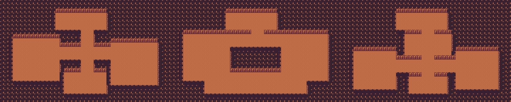

# Mengedit gua dan musuh di Godot

**Alur utama terbaru (19 Oktober 2026):** lantai tambang memakai scene dungeon utuh dan zona spawn. Mulai dari bagian **Layout dungeon utuh** di bawah. `Floor Scenes` lama tetap tersedia sebagai fallback dekorasi ketika `Dungeon Scenes` dikosongkan.

## Pembagian yang dipakai

- **Node/scene** untuk bentuk fisik dan tampilan: TileMap, tembok, marker posisi, enemy/boss, sprite, collider, lift dan tangga.
- **Resource `.tres`** untuk isi dan balancing: daftar lantai, jenis/jumlah musuh dan batu, bobot bijih, peluang drop, HP/damage, fase boss dan musik.
- **Skrip** untuk perilaku: memilih spawn acak berdasarkan hari/lantai, AI, hit/parry, transisi, dan save. Pengacakan tetap diperlukan; node hasilnya muncul di Scene → Remote saat Play.

## Layout dan posisi

Buka `scenes/world/cave/cave.tscn`:

| Node/properti | Kegunaan |
|---|---|
| `BaseLayerGround`, `CaveWalls` | Melukis lantai dan dinding |
| `Walls` | Collision batas ruangan |
| `Layout/Arrival` | Posisi tiba pemain; area sekitarnya dilindungi dari spawn |
| `Layout/LadderUp` | Posisi tangga naik di lantai tambang |
| `Layout/Lift` | Posisi lift di lantai checkpoint |
| `Layout/ArenaStart`, `ArenaEnd` | Sudut kiri atas dan kanan bawah arena; sisi atas menjadi fog gate |
| `Layout/BossExit` | Titik tangga setelah boss kalah (dibulatkan ke grid tile) |
| root → `Room Size`, `First Walkable Row` | Batas generator, dalam tile |
| root → `Ladder/Lift/Stairs/Arena Scene` | Prefab yang dipakai generator |
| `Lobby` | Tata letak lobi; pintu, toko, lift, dan lubangnya bisa digeser langsung |

Grid aset tetap **16 px**. Memperbesar `Room Size` bukan perintah membuat ubin otomatis: edit TileMap, `Walls`, batas kamera `Player/CharacterBody2D/Camera2D`, dan marker arena supaya sesuai. Marker lantai tambang tidak memindahkan node lobi; lobi diedit sendiri. Jika Arrival digeser, geser LadderUp di dekatnya juga. Letakkan marker di ruang yang bisa dipijak, dan pastikan ArenaEnd berada di kanan bawah ArenaStart.

## Isi acak per rentang lantai

Buka `resources/cave/cave_data.tres`, lalu expand `Bands`:

- `Ore Ids/Weights`, `Geode Ids/Chances`: tabel mineral dan drop.
- `Rock Min/Max`, `Enemies`, `Enemy Min/Max`: isi lantai.
- Grup **Penempatan**: `Enemy Safe Radius`, jumlah pilar, panjang maksimal pilar, radius aman pilar, dan jumlah dekorasi. Set `Pillar Min/Max` ke 0 untuk menghilangkan pilar acak.
- Nama tier, ikon, aksen dan tint tetap bisa diatur di sini.

Batu memakai `resources/cave/ores/<id>.tres`. Properti `Scene` menerima scene khusus; bila kosong memakai `scenes/objects/rock.tscn` dengan gambar dan statistik dari CaveOre.

## Scene enemy dan boss

- `scenes/combat/enemy.tscn`: root Enemy, CollisionShape2D, AnimatedSprite2D, Contact/CollisionShape2D.
- `scenes/combat/boss.tscn`: inherited scene dari enemy, memakai skrip Boss.
- Untuk varian, buat **New Inherited Scene**, tambah/ubah child node, lalu simpan. Isi properti **Scene** pada EnemyData/BossData `.tres` dengan varian tersebut. Scene enemy harus berakar Enemy, scene boss harus berakar Boss.
- Pada prefab yang direferensikan oleh EnemyData.Scene, biarkan **Data** kosong; spawn mengisinya otomatis. Ini menghindari referensi berputar antara scene dan Resource.
- Default collision dan animasi mengikuti data `.tres`, supaya balancing tetap konsisten.
- Aktifkan **Use Scene Collision** pada root prefab bila bentuk collider dari scene harus dipertahankan. Edit collider badan dan collider Contact.
- Aktifkan **Use Scene Animations** untuk memakai SpriteFrames buatan editor. Nama animasi mengikuti `idle_down/up/right/left`, `walk_*`, `attack_*`, `damage_*`, `dead_*`. SpriteFrames yang dibuat otomatis dari folder gambar baru terlihat saat Play.
- Untuk menaruh enemy secara manual, instance scene enemy lalu isi **Data** di Inspector. Jangan menaruhnya di `FloorContent` sebagai dekorasi tetap: isi container itu dibersihkan setiap ganti lantai. Spawn acak tetap mengikuti Bands.
- Skala gambar boss tetap mengikuti `BossData.sprite_scale`.

## Arena dan objek interaksi

- `scenes/world/cave/boss_arena.tscn`: atur `Gate Thickness`, `Enter Margin`, `Reset Delay`, dan `Boss Spawn Ratio` (0–1 dalam arena). Prefab ini diinisialisasi generator saat lantai boss dibangun.
- `ladder_up.tscn`, `lift.tscn`, `stairs_down.tscn` di folder yang sama: edit sprite/region/CollisionShape2D. Generator mempertahankan visual dan collider dari prefab.
- Fase, jurus, hadiah dan musik tetap di `resources/enemies/boss_*.tres`. Slot Music kosong memakai genderang sintetis.
- Fog, indikator serangan, dan proyektil masih dibuat oleh skrip; belum ada editor visual tersendiri untuk pola jurus.

Tidak ada perubahan format save; pengaturan layout dan prefab dibaca dari proyek, bukan disimpan per save.

## Verifikasi

Parser/editor, regresi gua, arena boss, override marker/prefab/collider, spawn/pilar, serta interaksi tangga/pintu (keyboard, mouse, dan input gamepad sintetis) lulus pada sesi ini. Tes mouse mengirim koordinat viewport langsung supaya tidak terkena transform stretch window dua kali saat headless. Pengujian ini belum menggantikan playtest visual/gamepad fisik.

## Konten lantai 41–100 (Gold, Frost–Ember, Shadow)

Batas aktif tetap lantai 100. Data setiap tier sekarang berupa file sendiri, terhubung melalui `CaveData.Bands`:

| Lantai | Resource Inspector | Musuh |
|---|---|---|
| 41–60 | `resources/cave/bands/gold.tres` | Slime Emas Tambang, Pemanah Emas, Myconid Sitrin |
| 61–80 | `resources/cave/bands/frost_ember.tres` | Slime Beku, Penyihir Bara, Penjaga Bara |
| 81–100 | `resources/cave/bands/shadow.tres` | Slime Bayangan, Pemanah Bayangan, Penyihir Bayangan |

Tier sebelumnya juga dipisah menjadi `stone`, `copper`, `amethyst`, dan `iron` di folder yang sama. Bijih, permata, geoda, dan persyaratan beliung tetap memakai data yang sudah ada. Statistik musuh baru adalah balancing awal, bukan keputusan final.

### Mengubah spawn dan tampilan

1. Buka file band → ubah `First/Last Floor`, `Enemies`, `Enemy Weights`, `Enemy Min/Max`, atau `Floor Scenes`.
2. Bobot sejajar urutan `Enemies`. Default 4:2:3; bobot 0 menonaktifkan musuh tersebut. Semua bobot 0 berarti lantai tanpa musuh. Kosong memakai bobot merata. Nilai negatif dianggap 0 dan entri musuh kosong dilewati.
3. Ubah statistik/drop di `resources/enemies/gold_*.tres`, `frost_slime.tres`, `ember_*.tres`, atau `shadow_*.tres`. Jangkauan proyektil juga tersedia melalui `Projectile Range`.
4. Buka prefab yang direferensikan `EnemyData.Scene` di `scenes/combat/cave/`. Animasi SpriteFrames, palette `AnimatedSprite2D.Modulate`, dan sprite tersimpan di scene, dapat dilihat sebelum Play. Tetap gunakan `Use Scene Collision` bila ingin mengatur collider sendiri.
5. File `scenes/world/cave/tiers/<tier>_a.tscn` dan `_b.tscn` adalah dua variasi layout per tier. Geser/tambah/hapus `CrystalOutcrop` serta edit `Sprite2D` atau `CollisionShape2D` langsung di editor. Outcrop adalah dekorasi solid, bukan node bijih yang ditambang.

Generator memilih salah satu `Floor Scenes` memakai seed hari+lantai. Collider RectangleShape2D atau CircleShape2D di bawah StaticBody2D pada template otomatis melarang spawn batu/musuh/pilar pada area tersebut. Perubahan posisi, skala dan rotasi collider ikut dibaca; collider disabled dilewati. Bentuk collider lain memerlukan `Reserved Regions` pada root template. Reserved Regions memakai koordinat grid gua, bukan relatif terhadap node prop. `Floor Scenes` kosong berarti tidak ada template tambahan; generator biasa tetap berjalan.

Template menambah isi ruangan, tidak mengganti TileMap dasar atau marker Arrival/Lift. Hindari menutup jalan dari titik tiba dan jangan menaruh rintangan pada marker penting. Arena boss lantai 60/80/100 tidak memakai dekorasi tambang ini agar telegraph dan jalur menghindar tetap lapang. Setelah boss dikalahkan dan lantainya kembali menjadi tambang, template tier kembali digunakan.

Tidak ada nama tier, daftar musuh, peluang tier atau koordinat outcrop yang ditentukan dalam cabang skrip. Semuanya berasal dari `.tres` dan `.tscn`; skrip hanya memilih, meng-instance, dan menjaga area spawn. Headless digunakan untuk tes otomatis, tidak menentukan struktur konten.

Verifikasi konten 41+: parser/editor, regresi gua, tier, dan deep cave lulus. Tes mencakup bobot spawn, template yang dipindah, pengecualian spawn oleh collider, seed harian, batas tier, pembersihan template, prefab yang bisa dilihat sebelum Play, dan pemulihan warna setelah damage. Collider outcrop memakai Resource terpisah agar ukurannya dapat diedit masing-masing. Playtest visual serta balancing jangka panjang tetap diperlukan.

## Layout dungeon utuh — 19 Oktober 2026

Tiga layout awal tersedia di `scenes/world/cave/layouts/`:

- `branching.tscn`: pintu masuk menuju cabang kiri, kanan, dan ruang bawah.
- `ring.tscn`: ruang kiri/kanan terhubung melalui jalur atas dan bawah, mengelilingi dinding tengah.
- `chambers.tscn`: rangkaian ruangan dengan kantong mineral di sisi kiri dan kanan.

Scene tersebut terhubung ke properti **Dungeon Scenes** pada setiap `resources/cave/bands/*.tres`. Pilihan bentuk, jenis isi, bobot, batas jumlah dan posisi berasal dari scene/Resource. Tidak ada daftar koordinat layout yang dijalankan dalam generator. Pilihan harian tetap memakai seed hari+lantai. Lantai danau yang ditentukan `CaveData.Lake Floor` dan arena boss mempertahankan scene khususnya.

### Mengubah bentuk lantai

1. Buka salah satu scene layout, atau duplikasikan menjadi variasi baru.
2. Lukis sel yang dapat dipijak pada **GroundTiles** menggunakan grid 16 px. Erase sel untuk mengubahnya menjadi tembok permanen.
3. Sesuaikan **WallTiles** untuk tampilan tebing/dinding. Collision fisik berasal dari sel non-ground, sehingga tidak perlu menggambar collider untuk setiap tile. Menggambar dinding visual saja tidak menutup jalur: hapus ground di tempat itu juga.
4. Edit marker **Arrival**, **LadderUp**, **Lift**, serta marker dalam **StairCandidates**. Tangga turun tetap tersembunyi sampai ditemukan melalui penambangan atau semua musuh kalah; posisinya dipilih dari kandidat yang bisa dicapai.
5. Semua ground harus terhubung dari Arrival. Titik kaki tangga/lift dan semua kandidat tangga juga harus dapat dicapai. Template invalid dilewati dengan peringatan, lalu generator mencoba template lain. Jika semuanya invalid, generator memakai bentuk persegi lama.
6. **Map Bounds** pada layout harus cocok dengan `Room Size` root gua; default `(0,0,40,24)`. Pertahankan transform root layout pada posisi nol, rotasi nol, dan skala 1; gunakan grid 16 px saat melukis/menggeser tile dan zona. Ukuran viewport, collision batas luar, dan kamera tetap mengikuti scene gua.

Props `StaticBody2D` dengan `CollisionShape2D` persegi/lingkaran ikut diperhitungkan dalam keterhubungan dan navigasi. Bentuk collider lain memerlukan penyesuaian ground agar generator mengetahui rintangannya. Collider dibaca konservatif dalam satuan tile. `Reserved Regions` pada root layout melarang spawn tanpa menghapus lantai yang bisa dilewati.

### Mengatur zona melalui Inspector

Setiap child pada **SpawnZones** memakai `CaveSpawnZone`. Kotaknya berwarna di editor dan disembunyikan saat bermain. Geser node untuk memindahkan zona, ubah **Size Tiles** untuk memperbesar, atau duplikasikan node untuk menambah zona.

| Kind | Isi |
|---|---|
| Rock | Batu biasa dan bahan dengan `CaveOre.Spawn Kind = ROCK` |
| Ore | Bijih logam dengan `Spawn Kind = ORE` |
| Gem | Permata/kristal dengan `Is Gem` atau `Spawn Kind = GEM` |
| Enemy | Musuh dari tabel tier atau `Enemy Pool` khusus zona |
| Safe | Area bebas spawn batu/musuh |

- **Spawn Weight** mengatur proporsi pengisian antarzona. Nilai 0 menonaktifkan zona; zona nonaktif tidak wajib menyentuh ground.
- **Minimum Count / Maximum Count** membatasi jumlah dalam zona. Minimum mengambil bagian dari budget tier, bukan menambah jumlah di luar budget. Jika jumlah minimum melebihi budget, urutan node menentukan alokasi awal. Kapasitas kosong, jalur aman dan whitelist tetap membatasi jumlah akhir.
- **Item Ids** membatasi mineral yang boleh muncul di zona; kosong memakai kategori tier. Hanya mineral yang juga terdaftar pada tier dan memiliki bobot positif yang dipakai. Bijih tier tinggi tidak muncul di lantai awal hanya karena nama item ditambahkan ke zona.
- **Enemy Pool** opsional mengatur penjaga zona tertentu; kosong mengikuti `Enemies/Enemy Weights` pada tier. Entri null dilewati.
- **Clustered** mengelompokkan endapan mineral yang sejenis di sekitar titik awal; **Cluster Radius** mengatur radiusnya dalam tile.
- Total batu/bijih/permata tetap memakai **Rock Min/Max** tier; total musuh tetap memakai **Enemy Min/Max** tier. Contoh scene menyediakan minimum endapan dan permata agar lantai tidak hanya berisi batu biasa.

Root layout **Protect Routes** melindungi rute terpendek dari Arrival ke kandidat tangga dan bagian tengah zona. Area Safe dan kandidat tangga tetap bebas spawn. Jangan mematikan perlindungan ini jika ingin menjamin jalan utama langsung terbuka tanpa menambang. Batu di luar jalan utama tetap bisa ditambang.

Enemy memakai navigasi grid berdasarkan ground dan batu yang masih ada ketika mengejar, memeriksa gangguan, atau berjalan pulang. Menambang batu memperbarui navigasi. Pola serang dan statistik tetap berasal dari EnemyData. Lobi dan arena boss tidak memakai navigasi grid lantai tambang.

### Menambah variasi aktivitas

Duplikasikan scene, lalu ubah zona dan simpan sebagai variasi baru: lebih banyak Ore/Gem untuk lantai tambang kaya mineral, lebih banyak Enemy untuk ruang pertempuran, atau zona Safe lebih luas untuk lantai tenang. Atur budgetnya pada band yang sesuai. Tambahkan scene baru ke **Dungeon Scenes** melalui Inspector. Sistem ini belum menambahkan peti harta, pintu berkunci, atau puzzle otomatis.

### Verifikasi

Tes `dungeon_layout_regression.tscn` memeriksa semua bentuk di setiap tier: keterhubungan, kategori/zona spawn, jumlah isi, jalur ke tangga tanpa menambang, navigasi musuh, perubahan whitelist dan batas jumlah via Inspector, pengacakan yang konsisten, penolakan template terputus, serta transisi kembali ke lantai khusus. Tes gua, tier legacy, deep cave dan interaksi pintu/tangga tetap dijalankan terpisah. Format save tidak berubah.

Preview bentuk dasar (kiri ke kanan: Cabang, Lingkar, Rangkaian Ruang), dirender dari scene TileMap di Godot sebelum diisi batu dan musuh:

Lantai tenang dengan budget batu dan musuh sama-sama nol langsung membuka tangga turun, sehingga pengaturan kosong tidak membuat pemain terjebak.
